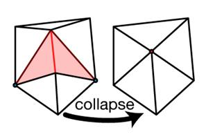
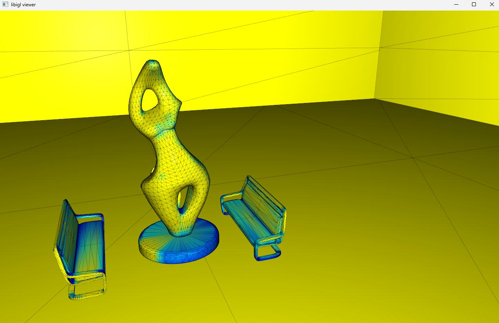

# MeshDecimation-libigl

**Undergraduate Thesis · Athens University of Economics and Business, Department of Informatics · 2025**

> **Authors:** C. Chrysafi · A. A. Manetas
>
> **Companion repository (visibility analysis — NVIDIA OptiX):** https://github.com/Heart-lex/MeshDecimation-OptiX
>
> **Full thesis:** [`doc/Mesh Decimation via Weighted Importance Mapping.pdf`](docs/Mesh%20Decimation%20via%20Weighted%20Importance%20Mapping.pdf)

---

## What this repository does

This is the **mesh simplification** half of a two-stage offline decimation pipeline. It takes:

- an OBJ mesh (any scene, any size)
- a plain-text per-triangle weight file produced by the companion OptiX repository

and simplifies the mesh using a **modified least-cost edge-collapse algorithm** that is biased by importance — triangles the virtual agent saw a lot are expensive to collapse; triangles it never saw are cheap.

The companion repository handles all the ray tracing and weight generation. This repository handles nothing but simplification.

---

## The weight file format

The weights file is a plain `.txt` file with one floating-point value per line, one line per triangle, in the same face order as the OBJ:

```
0.0312
0.8741
0.2200
0.0001
...
```

Values are normalised to `[0, 1]` by the OptiX stage before export. `1.0` is the most-viewed triangle; `0.0` is never seen. The number of lines must exactly match the face count of the OBJ — the code reads them into an `Eigen::VectorXd W` indexed directly by face id.

---

## How the cost function works

The core change from stock libigl is in `include/igl/shortest_edge_and_midpoint.cpp`. The original function computed cost purely as edge length:

```cpp
// Original libigl:
cost = (V.row(E(e,0)) - V.row(E(e,1))).norm();
```

This repository replaces that with importance-biased cost:

```cpp
// Modified:
double avg_weight = 0.0;
int count = 0;
int f0 = EF(e, 0);
int f1 = EF(e, 1);
if (f0 != -1) { avg_weight += g_weights(f0); count++; }
if (f1 != -1) { avg_weight += g_weights(f1); count++; }
if (count > 0) avg_weight /= count;

cost = 1.0 + avg_weight;
p = 0.5 * (V.row(E(e, 0)) + V.row(E(e, 1)));
```

The cost of collapsing an edge is the **average importance of its two adjacent faces**, offset by 1. The collapse point is always the midpoint.

This means:

| Face importance (avg) | Collapse cost | Priority |
|---|---|---|
| 0.0 — never seen | 1.0 | Collapses first |
| 0.5 — moderately seen | 1.5 | Collapses in the middle |
| 1.0 — most-viewed | 2.0 | Collapses last |

The ratio between the cheapest and most expensive collapsible edge is 1:2. This is intentional — the offset keeps the cost range narrow enough that the heap stays well-ordered without making critical faces uncollapsable.

The weights are injected via a small addition to the same file:

```cpp
static Eigen::VectorXd g_weights;

namespace igl {
    void set_weights(Eigen::VectorXd& W) {
        g_weights = W;
    }
}
```

`set_weights(W)` is called once during initialisation. The function is declared in `shortest_edge_and_midpoint.h` and called from `main.cpp` before the priority queue is built.

---

## Data structures

`igl::edge_flaps` computes four structures over the mesh that the collapse loop uses:

| Variable | Shape | Meaning |
|---|---|---|
| `E` | `#E × 2` | Each row is a pair of vertex indices forming one undirected edge |
| `EMAP` | `#F×3` | Maps each directed half-edge (face corner) to its index in `E` |
| `EF` | `#E × 2` | The two faces adjacent to each edge (`-1` if boundary) |
| `EI` | `#E × 2` | Which corner of each adjacent face the edge is opposite to |

The priority queue is an `igl::min_heap<tuple<double, int, int>>` — each entry stores `(cost, edge_id, timestamp)`. The timestamp is used to invalidate stale queue entries after a collapse recalculates affected edges.

---

## The collapse loop

Initialisation (inside the `reset` lambda):

```
1. F = OF; V = OV;               // reset to original mesh
2. edge_flaps(F, E, EMAP, EF, EI);
3. set_weights(W);                 // inject per-face importance weights
4. for each edge e:
     if isStructurallyImportant(e): cost = ∞
     else: shortest_edge_and_midpoint → cost = 1.0 + avg_weight(e)
     push (cost, e) into Q
5. face_target = F.rows() / decimation_factor
```

Per-frame animation step (inside `pre_draw`):

```
while face_counter > face_target and Q not empty:
    pop cheapest (cost, e) from Q
    call collapse_least_cost_edge(e, ...)
        → removes the two triangles sharing e
        → moves the lower-indexed vertex to the midpoint
        → recalculates all edges of the surviving one-ring
        → calls update_materials callback
    face_counter -= 2
```

Each edge collapse removes exactly two triangles. The mesh is re-displayed after each batch via `viewer.data().set_mesh(V, F)`.



---

## Structural guard

Before computing the weighted cost, each edge is tested by `isStructurallyImportant`. Edges that pass are assigned infinite cost and are never collapsed, regardless of their face weights:

| Condition | Threshold | Reason |
|---|---|---|
| Boundary edge | `EF(e,0) == -1` or `EF(e,1) == -1` | Collapsing would open a hole |
| Sharp crease | face normal dot product `< 0.5` (angle > 60°) | Hard surface feature |
| Long span | edge length `> 5.0` world units | Structural skeleton of large geometry |
| Invisible floor/wall | face weight `< 0.01` AND normal Y > 0.8 (floor) or Y < 0.3 (wall) | Prevent large invisible planes from collapsing into degenerate geometry |

The floor/wall check is applied only to faces with near-zero weight — highly visible floors are allowed to simplify normally.

---

## Material tracking

Standard libigl decimation discards material assignments. This implementation adds a `std::vector<std::string> currentFaceMaterials` that tracks which `usemtl` group each surviving face belongs to.

Material groups are parsed from the OBJ at load time:

```cpp
std::vector<MaterialGroup> parseMaterialGroups(filename);
std::vector<std::string> originalFaceMaterials = buildFaceMaterialMap(groups, OF.rows());
```

After each collapse, the `update_materials` post-collapse callback removes the two deleted faces from the vector:

```cpp
int minF = std::min(f1, f2);
int maxF = std::max(f1, f2);
currentFaceMaterials.erase(currentFaceMaterials.begin() + maxF);
currentFaceMaterials.erase(currentFaceMaterials.begin() + minF);
```

The max-index face is erased first to avoid index shifting affecting the min-index erase.

---

## Mesh with importance weights visible (libigl viewer)

The heatmap below is what the scene looks like inside the libigl viewer after loading — faces are coloured by their importance weight before any simplification begins. Warm (yellow-green) faces are high-importance; cool (blue) faces are low-importance and will collapse first.



---

## Mesh quality at different reduction levels

The three views below show the same apartment scene at 0%, 50%, and 85% triangle reduction. The wireframe reveals where the topology has been thinned — the floor, ceiling, and hidden surfaces lose detail fastest, while surfaces the agent walked past keep their triangulation.

| Original — 112,591 triangles | 50% reduced — 56,261 triangles | 85% reduced — 18,765 triangles |
|:-:|:-:|:-:|
|  |  |  |

---

## Output

Pressing `v` during the interactive session calls `saveSimplifiedMesh`, which writes the mesh to the desktop as `<original_name>_simplified.obj`. The writer (`writeOBJWithMaterialsAndUVs`) preserves:

- `mtllib` reference
- all `v` positions
- all `vt` UV coordinates
- all `vn` normals
- `f` entries in `v/vt/vn` format
- `usemtl` directives grouped by material

The original `.mtl` file is copied alongside the output OBJ automatically.

You can press `v` at any point — the mesh is saved at whatever reduction level the animation is currently at. Running the loop to different depths and saving each time produces a full LOD chain from a single run.

---

## Building

```bash
git clone https://github.com/Heart-lex/MeshDecimation-libigl.git
cd MeshDecimation-libigl
mkdir build && cd build
cmake .. -DCMAKE_BUILD_TYPE=Release
cmake --build . --config Release
```

The binary lands in `build/bin/`.  
All dependencies (libigl, Eigen, GLFW, ImGui, OpenGL) are fetched automatically by CMake. 

---

## Usage

```
./703_Decimation_bin <mesh.obj> <weights.txt> [decimation_factor]
```

| Argument | Type | Description |
|---|---|---|
| `<mesh.obj>` | required | Triangulated, manifold OBJ. Must be a single joined mesh. |
| `<weights.txt>` | required | Plain-text per-face weight file from the OptiX pipeline. |
| `[decimation_factor]` | optional, integer ≥ 2 | Target = `F.rows() / factor`. Default is 5 (→ 20% of original). |

The viewer opens with animation **paused**. Controls:

| Key | Action |
|---|---|
| `Space` | Start / pause the collapse animation |
| `v` | Save the mesh at the current reduction level |
| `r` | Reset to the original mesh |

---

## Input requirements

- **Manifold geometry.** Every edge must be shared by exactly two faces. Non-manifold edges cause `collapse_least_cost_edge` to silently skip collapses or corrupt the face table. Repair with Blender's *3D Printing Toolkit* → Mesh → Clean Up → Make Manifold.
- **Single joined mesh.** All objects joined before OBJ export (`Ctrl+J` in Blender). Separate objects produce misaligned face indices between the OBJ and the weight file.
- **OBJ format.** The face-index ordering of OBJ is stable across exporters. FBX, STL, PLY, and OFF all reorder faces, breaking the one-to-one correspondence between face `i` in the mesh and line `i` in the weight file.
- **Weight file length = face count.** The code reads exactly `OF.rows()` values. If the counts differ the weights will be misaligned from the start.

---

## Requirements

| Dependency | Version | Notes |
|---|---|---|
| CMake | ≥ 3.16 | |
| C++ compiler | C++17 | MSVC 2019+, GCC ≥ 9, Clang ≥ 9 |
| libigl | 2.5.0 | Header-only; fetched automatically |
| Eigen3 | — | Fetched automatically |
| OpenGL + GLFW + ImGui | — | Interactive viewer; fetched automatically |

This repository is **CPU-only**. The companion OptiX repository requires a CUDA-capable RTX GPU.

---

## Related Work

- **Xanthopoulos (2021)** — *[Evaluation of Illumination-Based Mesh Simplification](http://graphics.cs.aueb.gr/graphics/docs/Light_driven_mesh_simplification.pdf)* — direct predecessor using lighting-driven importance via OptiX + libigl
- **Liu et al.** — *[Seamless: Seam erasure and seam-aware decoupling of shape from mesh resolution](https://www.cs.toronto.edu/~jacobson/images/seamless-seam-erasure-and-seam-aware-decoupling-of-shape-from-mesh-resolution-siggraph-asia-2017-compressed-liu-et-al.pdf)* — seam-aware decimation extending QSlim
- **Lindstrom & Turk (2000)** — *[Image-Driven Simplification](https://faculty.cc.gatech.edu/~turk/my_papers/image_simp_tog2000.pdf)* — multi-view image metric for visibility-aware simplification
- **Garland & Heckbert (1997)** — *[Surface Simplification Using Quadric Error Metrics](https://www.cs.cmu.edu/~garland/Papers/quadrics.pdf)* — the foundational QSlim edge-collapse algorithm

---

## Authors

**C. Chrysafi** and **A. A. Manetas**  
Athens University of Economics and Business — Department of Informatics  
Athens, 2025

---

## License

This repository is a fork of [libigl](https://libigl.github.io/) v2.5.0.  
The libigl core is available under the [MPL2 license](LICENSE.MPL2).  
Copyleft modules are available under the [GPL license](LICENSE.GPL).  
Thesis-specific modifications are subject to the same MPL2 terms.
